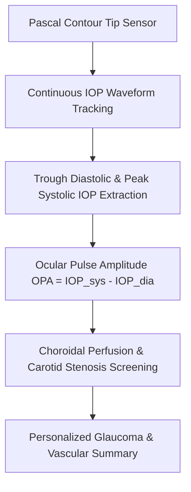

# Ocular Dynamic Contour Tonometry (DCT) & Ocular Pulse Amplitude (OPA) Skill

[](LICENSE)
[](https://www.python.org/)
[](https://modelcontextprotocol.io/)
[](requirements.txt)
[](https://github.com/alphaparkinc)

A zero-dependency, mathematically rigorous personal agent skill that evaluates corneal biomechanics-independent true intraocular pressure (IOP) and pulsatile choroidal microvascular perfusion using Pascal Dynamic Contour Tonometry.

## Architecture



## Quick Start

```python
from client import DynamicContourTonometryClient

client = DynamicContourTonometryClient()
result = client.evaluate_dct(
    iop_diastolic_mmhg=14.2,
    iop_systolic_mmhg=17.4,
    quality_score=1
)
print("OPA (mmHg):", result["dct_pressures_mmhg"]["ocular_pulse_amplitude_opa_mmhg"])
print("Perfusion Status:", result["hemodynamic_assessment"]["perfusion_state"])
```

## License
Apache-2.0
